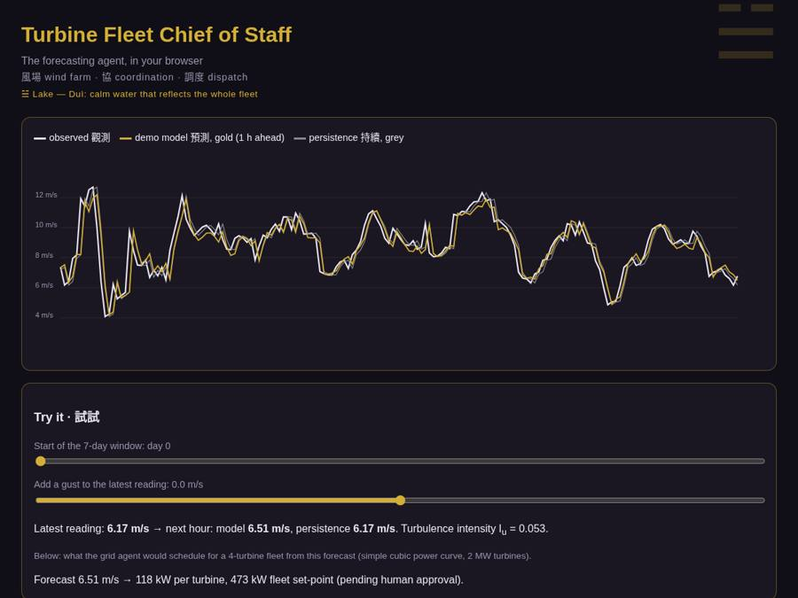

# Multi-agent 'AI chief of staff' for wind-turbine fleet operations

*風場 wind farm · 協 coordination · 調度 dispatch*

[](https://rishabh-bgp.github.io/multi-agent-turbine-fleet-chief-of-staff/) [](https://colab.research.google.com/github/Rishabh-bgp/multi-agent-turbine-fleet-chief-of-staff/blob/main/notebooks/walkthrough.ipynb) [](https://github.com/Rishabh-bgp/multi-agent-turbine-fleet-chief-of-staff/actions/workflows/ci.yml) [](LICENSE)  

[](https://rishabh-bgp.github.io/multi-agent-turbine-fleet-chief-of-staff/)

**Multi-agent turbine fleet chief of staff** is the reference implementation of my paper on a **multi-agent system for wind-turbine fleet operations**: an orchestrator coordinates a forecasting agent (CNN–BiLSTM–Attention), a SCADA monitoring agent, a maintenance agent, a grid/trading agent and a human-approval gate. The paper proposes an "AI chief of staff" that turns forecasts and sensor anomalies into prioritized work orders and power set-points, with a human always approving the final plan. This repo implements the agents as deterministic Python (no LLM calls).

**Try it:** [live demo](https://rishabh-bgp.github.io/multi-agent-turbine-fleet-chief-of-staff/) · [notebook in Colab](https://colab.research.google.com/github/Rishabh-bgp/multi-agent-turbine-fleet-chief-of-staff/blob/main/notebooks/walkthrough.ipynb)

## Live demo

The [live demo](https://rishabh-bgp.github.io/multi-agent-turbine-fleet-chief-of-staff/) runs a small version of the model directly in your browser. It shows one week of synthetic wind speed, the model's next-hour forecast (gold) and the persistence forecast (grey). Use the sliders to move through the test period or add a gust to the latest reading, and the forecast updates. The metrics are shown as red seal-style badges.

**About the design.** The look borrows from Chinese ink painting: dark paper, gold lines, crimson seals. Each repository has its own trigram from the I Ching and its own seal stamp. This one uses ☱ 兌 Duì, Lake, which stands for a calm lake that reflects everything around it, like the orchestrator that brings every agent's view together for the human approver. Across the series, 風 means wind and 預測 means forecast; the trigram for wind itself is ☴ 巽 Xùn. The motifs are decoration only and play no part in the method.

## Architecture · 架構

Six agents are defined as plain Python classes, with JSON-serialisable messages on a shared context bus and an audit log:
- **Orchestrator:** the chief of staff. It runs the planning cycle, resolves conflicts (turbines under stop orders are removed from dispatch), and is the only component that commits approved actions.
- **Forecasting agent:** a small CNN-BiLSTM-Attention model, wind speed → power through a power curve.
- **SCADA monitoring agent:** rolling z-score anomalies.
- **Predictive maintenance agent:** threshold rules on vibration and gearbox temperature. It produces a risk score and work orders with retrieved evidence from a tiny TF-IDF retriever over `knowledge/` (a stand-in for RAG).
- **Grid and trading agent:** proportional curtailment against a grid limit.
- **Reporting / human-in-the-loop agent:** an approval gate before anything is committed. It auto-approves in simulation; `--interactive` asks a human.

The simulator runs a fleet over the test period with injected degrading turbines. It reports forecast metrics against persistence, the fleet schedule error, curtailment and work orders.

## Quick start

```bash
python -m venv .venv && source .venv/bin/activate   # Windows: .venv\Scripts\activate
pip install -r requirements.txt
python -m src.simulate
python -m src.simulate --quick
python -m src.simulate --interactive   # approve each bundle by hand
```

Outputs: `runs/results.json`, `runs/audit_log.json` (git-ignored).

Run the tests with `pytest -q`. They include a check that the browser demo's JavaScript gives the same predictions as Python (uses `node` if it is installed).

## Notebook for examiners

[](https://colab.research.google.com/github/Rishabh-bgp/multi-agent-turbine-fleet-chief-of-staff/blob/main/notebooks/walkthrough.ipynb)

`notebooks/walkthrough.ipynb` is a simplified, step-by-step version of the method, with all its code inside the notebook. It is saved with its outputs, so you can read it without running anything.

To run it yourself:
1. Click **Open in Colab** above (or open the file in Anaconda Jupyter).
2. Choose **Runtime → Run all** (in Jupyter: **Run → Run All Cells**).
3. Wait about a minute on a normal CPU. All the code is inside the notebook, so it runs on its own; it fetches the synthetic CSV from this repository (or regenerates it) if the file is not next to it.
4. Read the printed table: the model's errors next to the *persistence* forecast ("next hour = this hour"). Lower MAE/RMSE and higher R² are better.

## Data · 數據

- **`data/synthetic/synthetic_scada.csv` is synthetic.** It was generated by the seeded script `scripts/make_synthetic.py`
  (seed 0; 120 days hourly: diurnal and seasonal cycles, AR(1) turbulence with gusty spells, plus direction, temperature, pressure, humidity and a logistic power curve). It contains no real measurements and exists so the code runs out of the box.
- The original SCADA data is confidential and is **not** included.
- Everything in `data/` except the synthetic CSV is git-ignored, so you can drop your own CSV there safely.
- To use your own data: pass `--csv path/to/scada.csv` with a `timestamp` and `wind_speed` column (optional: `wind_direction`, `temperature`, `pressure`, `humidity`, `power`; common Kaggle/SCADA aliases such as `Wind Speed (m/s)` are recognized). Data are resampled hourly.
- Regenerate the synthetic file: `python scripts/make_synthetic.py`

## Results vs persistence · 結果

These are the real numbers from this repository on **synthetic** data. They are not the paper's results and cannot be compared with them.
Both models predict the change from the last reading and are compared with persistence, the standard baseline for short-term wind forecasting.

| Model | MAE (m/s) | RMSE (m/s) | R² |
|---|---|---|---|
| Notebook model (1 h ahead) | 0.730 | 1.006 | 0.821 |
| Persistence (1 h ahead) | 0.779 | 1.079 | 0.794 |
| Browser demo model | 0.583 | 0.814 | 0.803 |
| Persistence (demo test period) | 0.656 | 0.886 | 0.767 |

In this short demo the model beats persistence on every row above. The browser demo uses a smaller model (ported to JavaScript); `python scripts/build_demo.py` rebuilds it.

MAE, RMSE (m/s), MAPE (%, computed only where observed wind speed ≥ 0.5 m/s to avoid division by near-zero) and R².

## About this implementation

> **Reference implementation of my paper**, rebuilt in Python on synthetic data because the original SCADA data is confidential. Results will differ from the published numbers, and nothing here claims to reproduce them.

- No LLM is used. The paper's agents are LLM-based (with an OpenAI Agents SDK mapping); here every agent is deterministic Python following the same role contracts, so the code runs offline without API keys.
- Weather/NWP, CMMS and market APIs are mocked. The knowledge snippets are illustrative and written for this repo, not real manuals or grid codes.
- The fleet is simulated from a single synthetic SCADA series using per-turbine scaling.
- The paper's curtailment and forecast improvements are not reproduced. With the tiny quick-mode training, the forecaster can be worse than persistence.

## Citation · 論文引用

Er. Rishabh Aryan (2026). "Multi-Agent AI Chief of Staff for Turbine Fleet Operations: Integrating Advanced Wind Speed Forecasting to Optimize Real Time Performance, Maintenance and Grid Integration." *International Journal of Artificial Intelligence and Computer Electronics*, 2(3), 1–32.

## License

MIT © 2026 Rishabh Aryan. See [LICENSE](LICENSE). The paper itself is not included.


## M.Tech in AI and Data Science, IIIT Bhagalpur: Thesis Work

Wind power forecasting reference implementations from my M.Tech thesis work at IIIT Bhagalpur, grouped by method.

### Quantum and hybrid quantum machine learning

| | Repository | Approach | Live |
|:---:|---|---|---|
| `08 ☰ 乾 Qian` | [hybrid-vqc-wind-speed-forecasting](https://github.com/Rishabh-bgp/hybrid-vqc-wind-speed-forecasting) | Hybrid variational quantum circuit (Conv1D-LSTM + VQC), PyTorch + PennyLane | [demo](https://rishabh-bgp.github.io/hybrid-vqc-wind-speed-forecasting/) |
| `10 ☵ 坎 Kan` | [cbma-tn-vqc-wind-green-hydrogen](https://github.com/Rishabh-bgp/cbma-tn-vqc-wind-green-hydrogen) | CNN-BiLSTM-MultiHead attention + tensor-network VQC, wind forecasting for green hydrogen | [demo](https://rishabh-bgp.github.io/cbma-tn-vqc-wind-green-hydrogen/) |
| `12 ☶ 艮 Gen` | [hcq-lstm-clqgwo-wind-forecasting](https://github.com/Rishabh-bgp/hcq-lstm-clqgwo-wind-forecasting) | Physics-informed hybrid classical-quantum LSTM tuned by a chaotic Lévy-flight quantum-inspired grey wolf optimizer | [demo](https://rishabh-bgp.github.io/hcq-lstm-clqgwo-wind-forecasting/) |

### Metaheuristic-optimized hybrids

| | Repository | Approach | Live |
|:---:|---|---|---|
| `04 ☷ 坤 Kun` | [geoai-hybrid-ga-pso-anfis-wind-forecasting](https://github.com/Rishabh-bgp/geoai-hybrid-ga-pso-anfis-wind-forecasting) | GeoAI hybrid: GA → PSO → ANFIS → CNN-LSTM probabilistic multi-site forecasting | [demo](https://rishabh-bgp.github.io/geoai-hybrid-ga-pso-anfis-wind-forecasting/) |

### Deep learning with attention and gating

| | Repository | Approach | Live |
|:---:|---|---|---|
| `05 ☲ 離 Li` | [xai-shap-lime-cnn-bilstm-attention-wind](https://github.com/Rishabh-bgp/xai-shap-lime-cnn-bilstm-attention-wind) | Explainable CNN-BiLSTM-Attention forecasting with SHAP and LIME | [demo](https://rishabh-bgp.github.io/xai-shap-lime-cnn-bilstm-attention-wind/) |
| `09+13 ☵ 坎 Kan` | [wuweidl-daoist-gated-wind-forecasting](https://github.com/Rishabh-bgp/wuweidl-daoist-gated-wind-forecasting) | WuWeiDL: Wu Wei gating and Feng-Qi turbulence encoding | [demo](https://rishabh-bgp.github.io/wuweidl-daoist-gated-wind-forecasting/) |
| `16 ☴ 巽 Xun` | [rso-net-wind-grid-stabilization](https://github.com/Rishabh-bgp/rso-net-wind-grid-stabilization) | RSO-Net: recursive self-optimizing TCN-Attention probabilistic forecasting with grid-stabilization proposals | [demo](https://rishabh-bgp.github.io/rso-net-wind-grid-stabilization/) |

### IoT, automation and multi-agent systems

| | Repository | Approach | Live |
|:---:|---|---|---|
| `14 ☳ 震 Zhen` | [iot-n8n-wind-turbine-predictive-maintenance](https://github.com/Rishabh-bgp/iot-n8n-wind-turbine-predictive-maintenance) | IoT + forecasting + n8n automation for wind-turbine predictive maintenance | [demo](https://rishabh-bgp.github.io/iot-n8n-wind-turbine-predictive-maintenance/) |
| `15 ☱ 兌 Dui` | **multi-agent-turbine-fleet-chief-of-staff** (this repo) | Multi-agent AI chief of staff for wind-turbine fleet operations | [demo](https://rishabh-bgp.github.io/multi-agent-turbine-fleet-chief-of-staff/) |

<!-- THESIS-PLACEHOLDER: add further thesis repos as rows in the matching group, ordered by paper number. -->

## Other repositories by Rishabh Aryan

- [geoai-hybrid-ga-pso-anfis-wind-forecasting](https://github.com/Rishabh-bgp/geoai-hybrid-ga-pso-anfis-wind-forecasting)
- [xai-shap-lime-cnn-bilstm-attention-wind](https://github.com/Rishabh-bgp/xai-shap-lime-cnn-bilstm-attention-wind)
- [wuweidl-daoist-gated-wind-forecasting](https://github.com/Rishabh-bgp/wuweidl-daoist-gated-wind-forecasting)
- [iot-n8n-wind-turbine-predictive-maintenance](https://github.com/Rishabh-bgp/iot-n8n-wind-turbine-predictive-maintenance)
